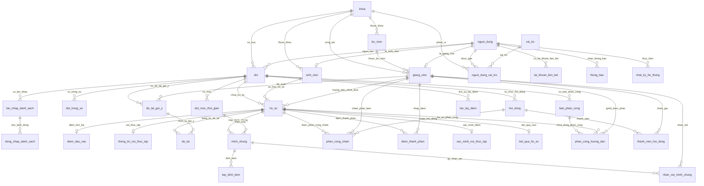

# SƠ ĐỒ THỰC THỂ QUAN HỆ CƠ SỞ DỮ LIỆU (ERD)
> **Dự án**: Hệ thống quản lý điều phối thực tập & đồ án tốt nghiệp  
> **Đơn vị**: Trường Kỹ thuật và Công nghệ – Đại học Vinh  
> **CSDL**: 32 Bảng chuẩn hóa theo 8 nhóm (A – H)

---

## 1. Cách mở xem sơ đồ trực quan (Khi thầy yêu cầu show Diagram)

### Cách A: Xem trực tiếp trong VS Code bằng file này (Nhanh nhất)
1. Mở file [ERD_DIAGRAM.md](file:///C:/Users/Admin/Documents/ProjectA/docs/ERD_DIAGRAM.md) này trong VS Code.
2. Nhấn tổ hợp phím **`Ctrl + Shift + V`** (hoặc `Ctrl + K, V`) để mở tab **Markdown Preview**.
3. Khối mã Mermaid bên dưới sẽ được tự động vẽ thành **sơ đồ đồ họa các bảng, các cột và đường nối quan hệ (1-n, 1-1, Foreign Key)** cực kỳ trực quan và sắc nét!

### Cách B: Xem qua Extension "Database Client" trong VS Code
1. Vào tab **Extensions** (`Ctrl + Shift + X`), cài tiện ích **`Database Client`** (tác giả *cweijan*).
2. Tại thanh bên trái (biểu tượng Database), chọn kết nối **SQLite**, trỏ tới file: `C:\Users\Admin\Documents\ProjectA\db.sqlite3`.
3. Bấm chuột phải vào kết nối -> Chọn **View ERD / Open Diagram**. Extension sẽ tự động sinh sơ đồ quan hệ dạng khối tương tác kéo thả hệt như trong SQL Server / MySQL Workbench.

---

## 2. Sơ đồ Mermaid ERD 32 Bảng dữ liệu

---

## 3. Danh mục 32 Bảng dữ liệu theo phân tầng

| STT | Tên bảng | File Model | Ý nghĩa nghiệp vụ |
|:---|:---|:---|:---|
| 1 | `khoa` | `organization/models.py` | Danh mục khoa (phạm vi dữ liệu) |
| 2 | `bo_mon` | `organization/models.py` | Danh mục bộ môn thuộc khoa |
| 3 | `nguoi_dung` | `accounts/models.py` | Tài khoản dùng chung hệ thống |
| 4 | `tai_khoan_lien_ket` | `accounts/models.py` | Liên kết SSO USMART / Google |
| 5 | `sinh_vien` | `organization/models.py` | Hồ sơ riêng của sinh viên |
| 6 | `giang_vien` | `organization/models.py` | Hồ sơ giảng viên (vai HD, PB, HĐ) |
| 7 | `vai_tro` | `accounts/models.py` | Danh mục vai trò (TKhoa, GV, QT) |
| 8 | `nguoi_dung_vai_tro` | `accounts/models.py` | Gán vai trò theo phạm vi khoa |
| 9 | `dot` | `dots/models.py` | Một đợt thực tập / đồ án tốt nghiệp |
| 10 | `dot_moc_thoi_gian` | `dots/models.py` | Các mốc hạn nộp tiến độ, báo cáo |
| 11 | `dot_trong_so` | `dots/models.py` | Tỷ lệ % các thành phần điểm |
| 12 | `lan_nhap_danh_sach` | `hoso/models.py` | Lịch sử tải file Excel danh sách |
| 13 | `dong_nhap_danh_sach` | `hoso/models.py` | Dòng dữ liệu bóc tách từ file Excel |
| 14 | **`ho_so`** | `hoso/models.py` | **Bảng trung tâm** theo dõi 7 trạng thái vòng đời |
| 15 | `diem_dau_vao` | `hoso/models.py` | Điểm TB tích lũy (Bảo mật: Chỉ Trưởng khoa xem) |
| 16 | `lan_lay_diem` | `hoso/models.py` | Nhật ký đồng bộ điểm từ USMART |
| 17 | `ban_phan_cong` | `phancong/models.py` | Bản phân công GVHD (Nháp -> Gửi -> Công bố) |
| 18 | `phan_cong_huong_dan` | `phancong/models.py` | Từng dòng phân công hồ sơ cho GVHD |
| 19 | `de_tai_goi_y` | `detai/models.py` | Đề tài do GVHD đề xuất cho SV chọn |
| 20 | `de_tai` | `detai/models.py` | Đề tài của từng hồ sơ và kết quả chốt |
| 21 | `thong_tin_noi_thuc_tap` | `thuchien/models.py` | Đơn vị thực tập (dùng xác minh chống giả mạo) |
| 22 | `minh_chung` | `thuchien/models.py` | Các lần nộp minh chứng tiến độ / báo cáo |
| 23 | `tep_dinh_kem` | `thuchien/models.py` | File báo cáo, mã nguồn, phiếu xác nhận scan |
| 24 | `nhan_xet_minh_chung` | `thuchien/models.py` | Nhận xét đánh giá của GVHD |
| 25 | `hoi_dong` | `chamdiem/models.py` | Hội đồng bảo vệ đồ án tốt nghiệp |
| 26 | `thanh_vien_hoi_dong` | `chamdiem/models.py` | Giảng viên trong hội đồng bảo vệ |
| 27 | `phan_cong_cham` | `chamdiem/models.py` | Phân công phản biện hoặc hội đồng |
| 28 | `diem_thanh_phan` | `chamdiem/models.py` | Điểm thành phần do người chấm nhập |
| 29 | `xac_minh_noi_thuc_tap` | `chamdiem/models.py` | Đối chiếu bản gốc có dấu & xác minh thực tập |
| 30 | `ket_qua_ho_so` | `chamdiem/models.py` | Điểm cuối tổng kết theo trọng số & lưu trữ |
| 31 | `thong_bao` | `hethong/models.py` | Thông báo trong ứng dụng cho người dùng |
| 32 | `nhat_ky_he_thong` | `hethong/models.py` | Nhật ký hành vi tác động (không ghi điểm) |
